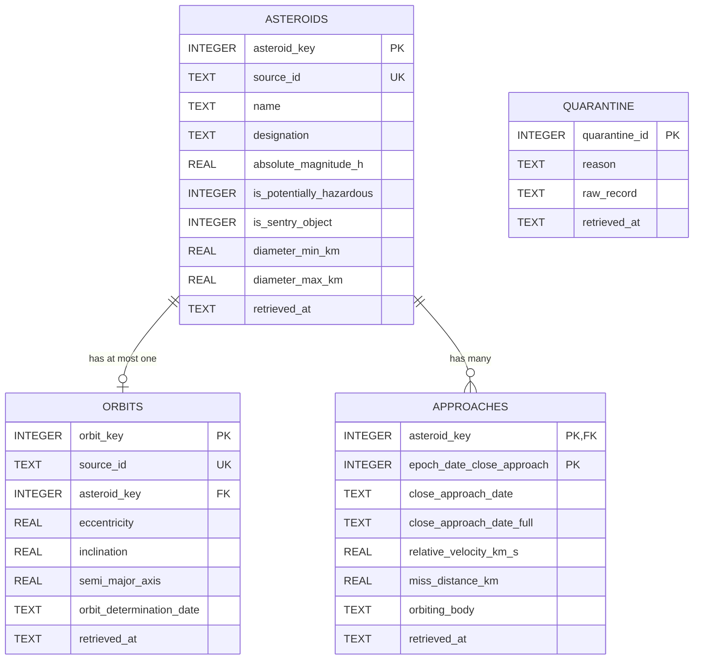

# NASA Near-Earth Asteroid Hazard Analysis

## Project Question

**Which asteroid features are linked to a “potentially hazardous” label?**

This project uses NASA's Near Earth Object Web Service (NeoWs) to collect data about near-Earth asteroids, their orbital characteristics, and close approaches. Asteroid, orbit, and close-approach data are connected using the asteroid ID to compare potentially hazardous and non-hazardous asteroids.

The project investigates which orbital and close-approach features are associated with the potentially hazardous label. A simple classifier will be developed in a later stage. Since the hazard label is built from absolute magnitude (H) and minimum orbit intersection distance (MOID), H, MOID, and diameter will not be used as model features. The hazard label is treated as a screening label, not an impact forecast.

---

## Data Sources

### NASA Near Earth Object Web Service (NeoWs)

The primary data source is NASA's Near Earth Object Web Service (NeoWs), a public REST API that provides JSON data about near-Earth asteroids.

The project uses the following NeoWs endpoints:

- **Browse** — provides the asteroid catalogue.
- **Feed** — provides close-approach data for a specified date range.
- **Lookup** — provides detailed information about an individual asteroid.

Official NASA API documentation:

https://api.nasa.gov/#asteroids-neows

Detailed source and provenance information is available in [`docs/sources.md`](docs/sources.md).

The API requires a NASA API key. The key must be provided through an environment variable and must never be committed to the repository.

### Data Entities

The project organizes the collected data into three entities, plus one table for records that cannot be loaded:

- **`asteroids`** — one row per asteroid.
- **`orbits`** — one row per asteroid orbit.
- **`approaches`** — one row per close-approach event.
- **`quarantine`** — one row per raw record that could not be loaded.

The entity tables are connected using the asteroid identifier.

The initial data collection target is at least 5,000 asteroids and their associated close-approach data.

---

## How to Run

### Prerequisites

- Python 3
- Git
- A NASA API key from the [NASA API portal](https://api.nasa.gov/) (only for ingestion, not for building the database)

### 1. Clone the repository

```bash
git clone https://github.com/se-220717030/nasa-data-pipeline.git
cd nasa-data-pipeline
```

### 2. Create a virtual environment

```bash
python -m venv .venv
```

### 3. Activate the virtual environment

**Windows:**

```powershell
.venv\Scripts\activate
```

**macOS / Linux:**

```bash
source .venv/bin/activate
```

### 4. Install dependencies

```bash
pip install -r requirements.txt
```

### 5. Configure the NASA API key

Create a local `.env` file in the repository root and configure the NASA API key using the environment variable expected by the ingestion script.

Check `.env.example` for the required variable name and format.

Never commit the `.env` file or expose API credentials in the repository.

### 6. Run the ingestion script (M1)

From the repository root, run:

```bash
python src/ingest.py
```

The ingestion script retrieves data from the approved NASA NeoWs endpoints and saves the raw responses in `data/raw/`.

Each run preserves the original responses and uses UTC retrieval timestamps in filenames. Subsequent runs create new files rather than overwriting previously retrieved files.

### 7. Build the database (M2)

From a fresh clone with landed raw data in `data/raw/`:

```bash
python src/load.py      # builds data/asteroids.db from scratch; safe to run again
python src/checks.py    # runs the six checks on a temporary copy (see Checks below)
```

`load.py` reads only the files in `data/raw/` and never calls the API. It creates `data/asteroids.db` if it does not exist. Running it again leaves the database unchanged.

---

## Repository Structure

```text
nasa-data-pipeline/
├── README.md
├── .gitignore
├── .env.example
├── requirements.txt
├── data/
│   └── raw/
├── docs/
│   └── sources.md
├── sql/
│   ├── schema.sql
│   └── queries/
└── src/
    ├── ingest.py
    ├── db.py
    ├── load.py
    ├── key_tests.py
    └── checks.py
```

### Directory and File Descriptions

| Path | Description |
|---|---|
| `README.md` | Project overview, data model, and instructions |
| `.gitignore` | Specifies files and directories Git should ignore |
| `.env.example` | Documents the required environment variables |
| `requirements.txt` | Lists the required Python dependencies |
| `data/raw/` | Stores raw data retrieved during ingestion |
| `data/asteroids.db` | Generated SQLite database; not committed to Git |
| `src/ingest.py` | Retrieves raw data from NASA NeoWs |
| `src/db.py` | Provides the shared `connect()` function and database initialization |
| `src/load.py` | Loads and validates raw data in the database |
| `src/key_tests.py` | Tests the key assumptions of the schema on the raw data |
| `src/checks.py` | Runs database integrity and loading checks |
| `sql/schema.sql` | Defines database tables, constraints, and indexes |
| `sql/queries/` | Stores analytical SQL queries |
| `docs/sources.md` | Documents data sources and provenance |

---

## Ingestion Scope — M1

Milestone M1 focuses on the ingestion stage of the data engineering lifecycle.

The ingestion script is designed to:

1. Retrieve data from the approved NASA NeoWs sources.
2. Save raw responses without cleaning, filtering, renaming, or reshaping them.
3. Include UTC retrieval timestamps in saved filenames.
4. Create new files on subsequent runs without overwriting previous files.
5. Read credentials from environment variables.
6. Handle request failures, timeouts, rate limits, and server errors.
7. Report the retrieved sources, record or file counts, and any errors.

Data cleaning, transformation, feature engineering, database loading, and machine learning are outside the scope of M1.

---

## Data Model — M2

Milestone M2 turns the landed raw files into a SQLite database that cannot contradict itself, refuses invalid data, and gives the same result however many times the load runs.

### ER diagram



`orbits` is shown with a subset of its columns; all columns are in `sql/schema.sql`. `quarantine` has no foreign key on purpose: it holds records whose entity we do not have.

### Grain of every table

- `asteroids`: one row is one near-Earth asteroid, identified by NASA's id.
- `orbits`: one row is the latest known orbital solution of one asteroid (at most one per asteroid).
- `approaches`: one row is one close approach of one asteroid at one moment (epoch).
- `quarantine`: one row is one raw record that could not be loaded, with the reason.

### Schema

The schema is in `sql/schema.sql` and uses `CREATE TABLE IF NOT EXISTS` and `CREATE INDEX IF NOT EXISTS`, so it can be run repeatedly.

- All four tables are `STRICT`.
- Entity tables have a surrogate `INTEGER PRIMARY KEY`; NASA's id is kept as `source_id TEXT NOT NULL UNIQUE`.
- `approaches` has the composite primary key `(asteroid_key, epoch_date_close_approach)`; every key column is `NOT NULL`.
- `orbits.asteroid_key` is `UNIQUE`, so an asteroid has at most one orbit row.
- Every relationship is a declared foreign key, and enforced: `connect()` in `src/db.py` runs `PRAGMA foreign_keys = ON` right after connecting, and every script uses it.
- Every table has `retrieved_at` (UTC), taken from the timestamp in the name of the raw file the row came from.
- Timestamps are ISO 8601 UTC text (`1901-08-23T17:36Z`); dates are zero-padded `YYYY-MM-DD`.
- Asteroid status flags are constrained to `0`, `1`, or `NULL`.

### The loader

`python src/load.py` reads every `.json` file in `data/raw/` (both the `browse` shape, a list of asteroids, and the `feed` shape, asteroids grouped by date) and loads three entity/event tables plus quarantine.

- **Deduplication by key, not by row.** Records are grouped by their key; the version with the latest `retrieved_at` wins. The decision uses the timestamp in the file name, never the order in which files are read.
- **Upserts.** All writes use `INSERT ... ON CONFLICT ... DO UPDATE` with a guard on `retrieved_at`. No `INSERT OR REPLACE` (it would change surrogate keys) and no `df.to_sql`.
- **Atomic.** The whole load runs in one transaction (`with con:`). A broken raw file stops the run before anything is written; an error during writing rolls everything back. The schema is created before the transaction starts.
- **Parameterised.** Every value reaches SQL through a `:name` or `?` placeholder.
- **Validation.** Text where a number belongs becomes `NULL` and is counted. Timestamps are converted to ISO 8601 UTC before insertion.

### Run summary

Output of two consecutive runs on a fresh database, built from the 4 landed raw files:

```text
# run 1
files read: 4 raw files (2026-10-12 .. 2026-10-12)
asteroids: 62 in database (+62 this run)
orbits: 40 in database (+40 this run)
approaches: 1,158 in database (+1158 this run)
values cleaned: 0 (non-numeric/invalid -> NULL)
quarantined: 0 in table (+0 this run)
foreign_key_check: OK
STATUS: COMPLETE

# run 2
files read: 4 raw files (2026-10-12 .. 2026-10-12)
asteroids: 62 in database (+0 this run)
orbits: 40 in database (+0 this run)
approaches: 1,158 in database (+0 this run)
values cleaned: 0 (non-numeric/invalid -> NULL)
quarantined: 0 in table (+0 this run)
foreign_key_check: OK
STATUS: COMPLETE
```

### Decisions and findings

**Keys.**
- Asteroid: surrogate `asteroid_key`; NASA's `id` is kept as `source_id`.
- Approach: `(asteroid_key, epoch_date_close_approach)`. The epoch is an integer in milliseconds since 1970 (UTC), so no time-zone conversion is needed.
- Tests, run on the 4 landed raw files with `src/key_tests.py`:
  - Uniqueness: 0 duplicate (asteroid id, epoch) pairs within any single file, so the event key held.
  - Stability: 0 asteroids changed name between files, and 0 keys had more than one `miss_distance` value across files.
  - Orbiting body: 0 keys had more than one `orbiting_body`, so leaving it out of the key is safe on this data.
  - References: approaches and orbits are nested inside their asteroid in the source, so every one resolves by construction. The load confirmed it: 0 quarantined records and `foreign_key_check: OK`.
  - Limit of these tests: all raw files were retrieved on 2026-10-12, so they say little about how values change over several days. We will re-check once more retrievals exist.

**Missing values.** A field that is absent in the source is stored as `NULL` and means "not provided by the source", never zero. A value that is present but cannot be converted (for example text where a number belongs) is also stored as `NULL` and counted in the run summary as "values cleaned". In the current data this count is 0.

**Timestamps.** `close_approach_date_full` ("1901-Aug-23 17:36") and `orbit_determination_date` ("2026-10-11 06:57:01") are assumed to be UTC and stored as ISO 8601. If `close_approach_date` is invalid, it is derived from the epoch and counted as cleaned.

**Unknown references.** A record that points to an asteroid we do not have goes to the `quarantine` table with a reason and its raw JSON; it is neither dropped nor does it stop the load. Quarantine writes are idempotent (`UNIQUE` plus `ON CONFLICT DO NOTHING`). Because approaches and orbits arrive nested inside their asteroid, orphans are not expected; the quarantine mostly catches records without an id or with an invalid epoch. Current count: 0.

**Change over time.** We use type 1: the version with the latest `retrieved_at` wins. A renamed asteroid is updated in place and keeps its `asteroid_key`. M6 may revisit this.

**Known issues.**
- 22 of 62 asteroids have no orbit row and no `designation`. The file `feed_20261012T134632Z_2026-10-09_to_2026-10-12.json` is the only raw file without `orbital_data` (checked with `grep -L orbital_data data/raw/*.json`), and these asteroids appear only there. The schema allows asteroids without orbits; the data can be completed later from the `browse` endpoint.
- All 4 raw files were retrieved on 2026-10-12, so the "latest retrieval wins" rule has only been exercised within one day.
- Raw files come in two shapes (`browse` and `feed`); the loader handles both.
- We have not checked whether `epoch_date_close_approach` and `close_approach_date_full` always describe the same instant.

### Checks

`src/checks.py` runs against a temporary copy of the database (never the real one) and reports PASS or FAIL for: duplicate natural key, orphan event, NULL key, wrong type, idempotence, and atomicity.

> **TODO (Member 3):** paste the output of `python src/checks.py` here once all six checks pass.

### Analytical query

> **TODO (Member 3):** paste `sql/queries/asteroid_analysis.sql` and its output here. The query must start with a comment stating its question and result grain, and why the aggregation is correct at that grain.

---

## Planned Analysis

In a later project stage, the asteroid, orbit, and close-approach data will be joined using the asteroid ID.

The analysis will compare potentially hazardous and non-hazardous asteroids and investigate associations between the hazard label and orbital or close-approach characteristics.

Absolute magnitude (H), minimum orbit intersection distance (MOID), and diameter will be excluded from predictive features, as specified in the project proposal.

Because potentially hazardous asteroids may be less common than non-hazardous asteroids, model evaluation will emphasize recall and PR-AUC rather than accuracy alone.

The objective is to investigate associations with a screening label, not to forecast asteroid impacts.

---

## Team

- **Rana Yalçın** — `@se-220717030`
- **Burak Avşar** — `@se-220717054`
- **Elif Şahin** — `@se-230717060`

---

## Status

**M1 — ingestion complete.**

**M2 — schema and loader complete and tested (idempotent, atomic, parameterised).** Still to finish before tagging: `src/checks.py` results and the analytical query (see TODOs above). Update this line to “M2 — schema and load complete.” once both are in.